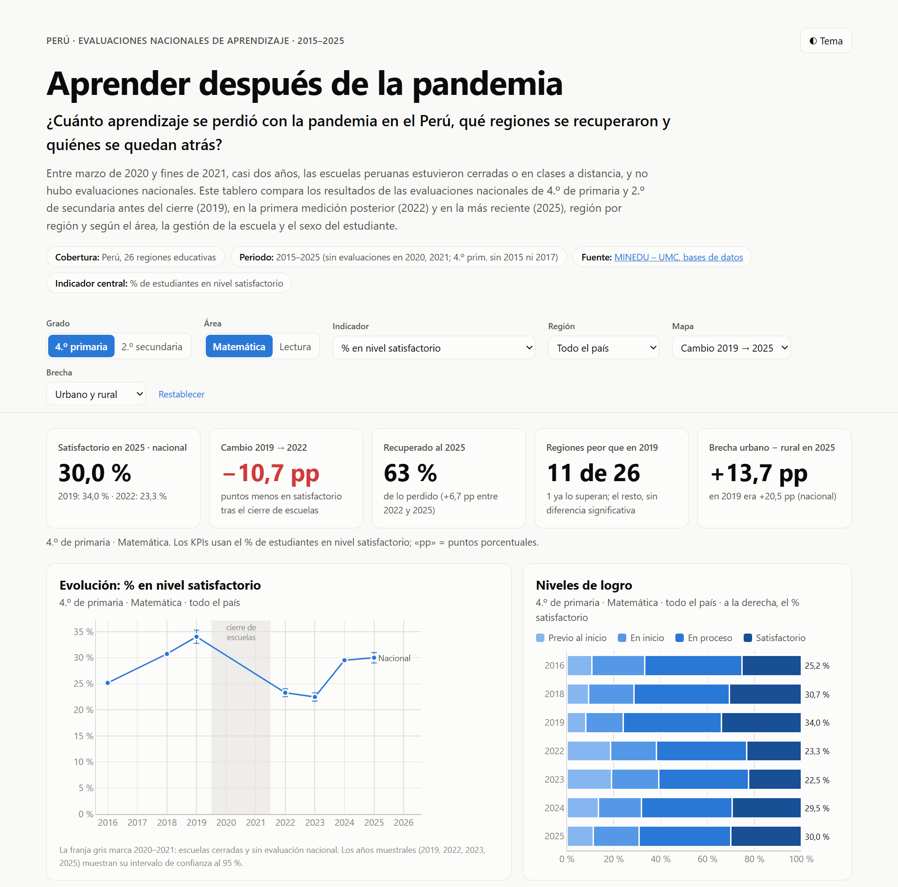
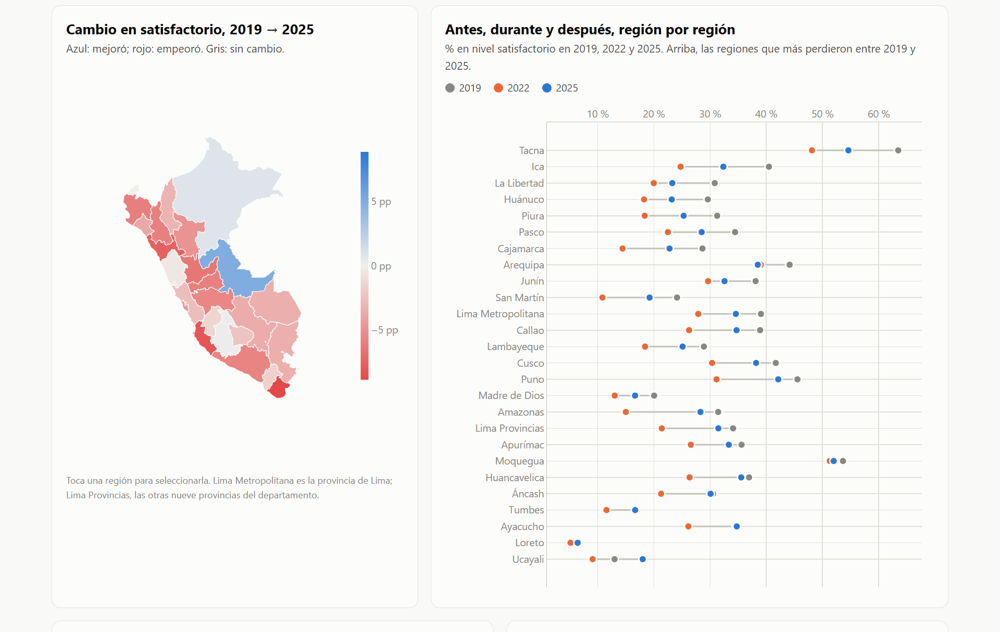

# Aprender después de la pandemia

**Luis Gabriel Guevara Vega** · Tarea 3 · Python Intermedio · Diplomatura de QLab, PUCP · octubre de 2026

- **Dashboard público:** https://luisguevaravega.github.io/python_interm_dip_qlab/tarea_3/web/
- **Publicación de LinkedIn:** _(pendiente)_
- **Reel:** [`reel/`](reel/) _(en preparación)_



## 1. Tema y pregunta de investigación

**Tema:** los aprendizajes de los escolares peruanos antes y después del cierre de escuelas por la pandemia.

**Pregunta:** *¿Cuánto aprendizaje se perdió con la pandemia en el Perú, qué regiones se recuperaron y quiénes se quedan atrás?*

**Cobertura:** Perú, las 26 regiones educativas, 4.º de primaria (2016–2025) y 2.º de secundaria (2015–2025), en Lectura y Matemática. En 2020 y 2021 no hubo evaluaciones.

## 2. El proyecto

Entre marzo de 2020 y fines de 2021 las escuelas estuvieron cerradas o en clases a distancia. Este proyecto toma los resultados oficiales de las evaluaciones nacionales y compara tres momentos:
- **antes** (2019),
- la **primera medición después del cierre** (2022),
- **la más reciente** (2025).

Los compara región por región y por estrato: área urbana o rural, escuela pública o privada, niños y niñas.

El producto principal es un dashboard interactivo con:
- **5 KPIs**: satisfactorio en 2025, caída 2019→2022, % recuperado, regiones peor que en 2019 y la brecha elegida.
- **6 visualizaciones**: evolución nacional con intervalos de confianza, distribución por nivel de logro, mapa de las 26 regiones, comparación por región en 2019, 2022 y 2025, pérdida frente a recuperación por región, y brechas.
- **Una tabla** ordenable por región.
- **Filtros**: grado, área, indicador (% satisfactorio, % debajo de lo esperado o puntaje promedio), región (también se elige al tocar el mapa, los gráficos o la tabla), vista del mapa y brecha. El estado de los filtros queda en la URL, así que cualquier vista se puede compartir.
- **Descarga** en CSV de los datos filtrados.
- **Modo claro y oscuro.**



## 3. Fuentes de datos y metodología

**Fuente única de los datos:** Oficina de Medición de la Calidad de los Aprendizajes (UMC) del MINEDU, [Bases de datos](http://umc.minedu.gob.pe/bases-de-datos/) de las evaluaciones nacionales de logros de aprendizaje. Descargadas el 30 de octubre de 2026; el registro de cada descarga (URL, fecha y tamaño) está en [`datos/originales/descargas.csv`](datos/originales/descargas.csv). Se usan 12 archivos Excel:

| Archivo | Contenido |
|---|---|
| `dre_4p_nivel`, `dre_4p_medida` | 4.º de primaria por región, 2016–2025: % por nivel de logro y medida promedio |
| `estratos_4p_nivel`, `estratos_4p_medida` | 4.º de primaria nacional y por estrato (sexo, gestión, área, tipo de escuela) |
| `dre_2s_2015_2022_*`, `dre_2s_2023_2025_*` | 2.º de secundaria por región |
| `estratos_2s_2015_2022_*`, `estratos_2s_2023_2025_*` | 2.º de secundaria nacional y por estrato |

Las evaluaciones son censales (ECE: 4.º de primaria 2016, 2018 y 2024; 2.º de secundaria 2015–2019) o muestrales, con error estándar (4.º de primaria 2019, 2022, 2023 y 2025; 2.º de secundaria 2022, 2023 y 2025). Los **límites de las regiones**, que solo sirven para dibujar el mapa, son de [juaneladio/peru-geojson](https://github.com/juaneladio/peru-geojson).

**Procesamiento** ([`scripts/procesar_datos.py`](scripts/procesar_datos.py)):
- Cada hoja de Excel (una por área) pasa a una tabla larga: grado, área, dimensión, grupo, año, % por nivel, error estándar y medida promedio. Resultado: [`datos/procesados/resultados.csv`](datos/procesados/resultados.csv), 952 filas.
- **Controles** ([`control.json`](datos/procesados/control.json)): los cuatro niveles suman 100 % en todas las filas (desvío máximo 0,0000 pp), las 26 regiones están en los 14 pares grado-año y ninguna fila queda sin medida promedio.
- **Mapa:** Lima se divide como en las bases de la UMC. Lima Metropolitana es la provincia de Lima y Lima Provincias son las otras nueve provincias del departamento (unión de polígonos con `shapely`).

**Indicadores** ([`scripts/analizar_datos.py`](scripts/analizar_datos.py)):
- **% satisfactorio:** estudiantes que lograron lo esperado para su grado.
- **% debajo de lo esperado:** suma de «en inicio» y «previo al inicio».
- **Pérdida** = 2022 − 2019; **recuperación** = 2025 − 2022; **cambio neto** = 2025 − 2019, en puntos porcentuales (pp).
- **Recuperado** = recuperación ÷ pérdida.
- **Brecha** = diferencia en % satisfactorio entre dos grupos (urbano − rural, privada − pública, niños − niñas).
- **Significancia:** un cambio es significativo al 95 % si |diferencia| > 1,96 × √(ee₁² + ee₂²), con los errores estándar que publica la UMC. Los años censales se tratan sin error muestral.

## 4. Hallazgos principales

1. **Matemática fue el área más golpeada y no ha vuelto a su nivel.**
   - En 4.º de primaria, el % satisfactorio bajó de 34,0 % (2019) a 23,3 % (2022), es decir, −10,7 pp.
   - En 2025 llega a 30,0 %: se recuperó el 62,5 % de lo perdido, pero sigue 4,0 pp debajo de 2019, una diferencia significativa.
   - En 2.º de secundaria no hubo recuperación (17,7 % → 12,7 % → 12,7 %), y 18 de las 26 regiones siguen significativamente por debajo de 2019.
2. **Se abrió una brecha de género en matemática.**
   - En 4.º de primaria, niños y niñas estaban casi iguales en 2019 (34,7 % y 33,3 % en satisfactorio).
   - En 2025, los niños están en 34,6 % y las niñas en 25,2 %: la brecha pasó de 1,3 a 9,4 pp (con los valores sin redondear: 34,66 − 33,33 en 2019).
   - En 2.º de secundaria creció de 4,1 a 6,2 pp. En lectura, las niñas siguen por delante.
3. **Las regiones que estaban más arriba cayeron más; varias del sur andino y la Amazonía ya superan 2019.**
   - En matemática de 4.º de primaria, Tacna pasó de 63,5 % a 48,1 % y está en 54,6 % (−8,9 pp frente a 2019); Ica sigue −8,1 pp.
   - En matemática de secundaria, Apurímac (+3,8 pp), Huancavelica (+3,1 pp) y Ucayali (+2,1 pp) ya superan 2019 de forma significativa.
   - La brecha urbano–rural en matemática de primaria se acortó de 20,5 a 13,7 pp, en parte porque bajó el resultado urbano.

Un cuarto hallazgo: **lectura resistió mejor**. En 4.º de primaria bajó de 34,5 % a 30,0 % y está en 32,7 %. En 2.º de secundaria subió de 14,5 % a 18,5 %; 19 regiones están significativamente por encima de 2019 y ninguna por debajo.

Todas las cifras salen de [`datos/procesados/indicadores.json`](datos/procesados/indicadores.json).

## 5. Limitaciones

- No hubo evaluaciones en 2020 ni 2021: no se observa el punto más bajo, solo la primera medición posterior (2022).
- Se mezclan evaluaciones censales y muestrales. Las diferencias chicas en años muestrales pueden ser error de muestreo; el dashboard marca cuáles son significativas.
- La UMC publica 2.º de secundaria en dos archivos (2015–2022 y 2023–2025). Aquí se leen como una sola serie: las cifras empalman, pero no encontré una nota oficial de comparabilidad.
- Quién rinde la prueba también cambió. La deserción y los traslados entre escuelas durante la pandemia pueden mover los promedios sin que cambie el aprendizaje de cada estudiante.
- El análisis es descriptivo, no causal: la caída coincide con el cierre de escuelas, pero en el periodo hubo otros cambios.
- Solo se analizan Lectura y Matemática. 2.º de secundaria también evalúa Ciencias Sociales y Ciencia y Tecnología.

## 6. Enlaces

- Dashboard: https://luisguevaravega.github.io/python_interm_dip_qlab/tarea_3/web/
- LinkedIn: _(pendiente)_
- Datos originales: http://umc.minedu.gob.pe/bases-de-datos/

## 7. Cómo reproducirlo

Se necesita [`uv`](https://docs.astral.sh/uv/). Desde `tarea_3/`:

```bash
uv sync                                         # entorno con pandas, openpyxl, shapely, httpx
uv run python scripts/obtener_datos.py          # baja los 12 Excel de la UMC y los límites de las regiones
uv run python scripts/procesar_datos.py         # → datos/procesados/resultados.csv, regiones.geojson, control.json
uv run python scripts/analizar_datos.py         # → datos/procesados/indicadores.json y web/data/
cd web && uv run python -m http.server 8000     # abrir http://localhost:8000
```

Sin `uv`: `pip install -r requirements.txt` y los mismos comandos con `python`. El dashboard es HTML estático: `web/index.html`, `web/assets/` (estilos y JavaScript con [Plotly.js](https://plotly.com/javascript/) 2.35.2) y `web/data/`. Se publica con GitHub Pages.

```
tarea_3/
├── datos/originales/   12 Excel de la UMC, límites de las regiones, registro de descargas
├── datos/procesados/   resultados.csv, regiones.geojson, indicadores.json, control.json
├── scripts/            obtener_datos.py → procesar_datos.py → analizar_datos.py
├── web/                el dashboard (index.html, assets/, data/)
├── figuras/            capturas del dashboard
└── reel/               guion, subtítulos y recursos del reel
```

## 8. Uso de inteligencia artificial

Usé **Claude Code** (Anthropic) para buscar las fuentes de datos, escribir los scripts de Python y el código del dashboard, y redactar los textos. Yo elegí el tema, la pregunta y los enfoques. Las cifras de los hallazgos salen de los scripts, no del modelo, y las revisé contra las bases originales de la UMC.
