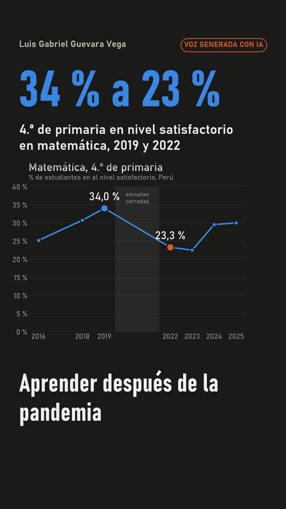

# Reel: Aprender después de la pandemia

Reel vertical de 57 s (1080 × 1920, 30 fps) que cuenta los hallazgos del [dashboard](https://luisguevaravega.github.io/python_interm_dip_qlab/tarea_3/web/). Lo narra **mi voz clonada con IA** (Qwen3-TTS) e incluye figuras hechas con los datos, música de fondo y subtítulos palabra por palabra.

- **Video:** [`salidas/reel.mp4`](salidas/reel.mp4) · subtítulos [`salidas/reel.srt`](salidas/reel.srt) · portada [`salidas/portada.png`](salidas/portada.png)
- **Guion:** [`guion.json`](guion.json)
- **Control de la voz:** [`salidas/control_voz.json`](salidas/control_voz.json)



## Cómo se hizo

| Paso | Qué hace | Archivo | Control |
|---|---|---|---|
| 1. Guion | 6 escenas y 142 palabras. Cada escena tiene la frase (con los números en palabras, para la voz), la cifra y la etiqueta en pantalla, la figura y la lista `datos`, que dice de dónde sale cada número | `guion.json` | `verificar_guion.py` compara las 20 cifras con `datos/procesados/` y no deja narrar si alguna no cuadra. También revisa que todo número en pantalla esté respaldado |
| 2. Figuras | 5 gráficos con los datos procesados y una captura del tablero publicado, con los colores del dashboard en modo oscuro | `figuras_reel.py` → `figuras/` | Salen de `resultados.csv`, `indicadores.json` y `regiones.geojson` |
| 3. Voz | Qwen3-TTS 0.6B clona mi voz a partir de una grabación mía de 15 s y narra cada escena, en CPU | `hacer_reel.py --solo-voz` | Whisper vuelve a escuchar cada escena: si falla más del 25 % de las palabras, la regenera |
| 4. Video | Audio a −14 LUFS, música 15 LU por debajo, subtítulos con tiempos de Whisper y video con Pillow y ffmpeg | `hacer_reel.py --solo-video` | Aviso «VOZ GENERADA CON IA» y fuente de los datos en pantalla todo el video; tarjeta final con enlace y créditos |

El código parte del de mi reel de incendios ([reel-incendios](https://github.com/LuisGuevaraVega/reel-incendios)), que sigue el flujo de la [sesión 15 del curso](https://github.com/d2cml-ai/Data-Science-Python/tree/main/sessions/15-texto-a-reel). Para este reel le agregué la música, la fuente siempre visible, la tarjeta de créditos y los colores del tablero.

## Resultado

| | |
|---|---|
| Duración | 57,4 s: 50,4 s de voz en 6 escenas, pausas y 5 s de tarjeta final |
| Voz | 12 min de cálculo en CPU (≈ 14 s por segundo de audio). Whisper entendió 5 de 6 escenas sin errores |
| Escena 5 | En la primera versión Whisper oyó «Kajali»: se perdía la U de **Ucayali**. La regeneré y elegí la toma en que Whisper (medium, sin contexto) oye «Ukayali», que es la misma pronunciación con otra ortografía |
| Audio | Mezcla final a −14,2 LUFS; la voz sola, a −14,3 LUFS |
| Archivo | H.264 + AAC, 3,2 MB |

## Créditos y licencias

- **Datos:** MINEDU – Oficina de Medición de la Calidad de los Aprendizajes (UMC), [bases de datos de las evaluaciones nacionales](http://umc.minedu.gob.pe/bases-de-datos/), 2015–2025.
- **Música:** «Clean Soul», Kevin MacLeod ([incompetech.com](https://incompetech.com)). Licensed under Creative Commons: By Attribution 4.0 License, http://creativecommons.org/licenses/by/4.0/. Se usan los primeros 90 s ([`recursos/musica_clean_soul.mp3`](recursos/musica_clean_soul.mp3)), con fundido de entrada y salida y volumen bajo la voz.
- **Voz:** generada con [Qwen3-TTS 0.6B](https://huggingface.co/Qwen/Qwen3-TTS-12Hz-0.6B-Base) (Alibaba, Apache 2.0) a partir de **mi propia voz**. Subtítulos y control con [faster-whisper](https://github.com/SYSTRAN/faster-whisper) (MIT).
- **Fuente tipográfica:** Bahnschrift (Windows).

## Ética

- **Solo mi voz.** La grabación original no está en el repositorio (`privado/` está en `.gitignore`): con ella cualquiera podría clonarme.
- **Aviso de IA** visible durante todo el video y en los créditos.
- **Nada se narra sin verificar**: cada cifra del guion se comprueba contra los datos antes de generar la voz.

## Cómo reproducirlo (Windows)

```bash
# entorno del reel, aparte del de los datos (qwen-tts fija transformers==4.57.3)
uv venv .venv-reel --python 3.12
uv pip install --python .venv-reel/Scripts/python.exe -r requirements.txt

# desde tarea_3/reel/
uv run --project .. python verificar_guion.py         # las cifras del guion salen de los datos
uv run --project .. python figuras_reel.py            # figuras/ (la sexta es una captura del tablero con Edge)
.venv-reel/Scripts/python.exe -X utf8 hacer_reel.py --voz privado/mi_voz.mp4 --texto-voz "lo que dice la grabación" --solo-voz
.venv-reel/Scripts/python.exe -X utf8 hacer_reel.py --solo-video
```

La grabación de voz va en `privado/mi_voz.mp4` (15 a 25 s, en un cuarto callado).
