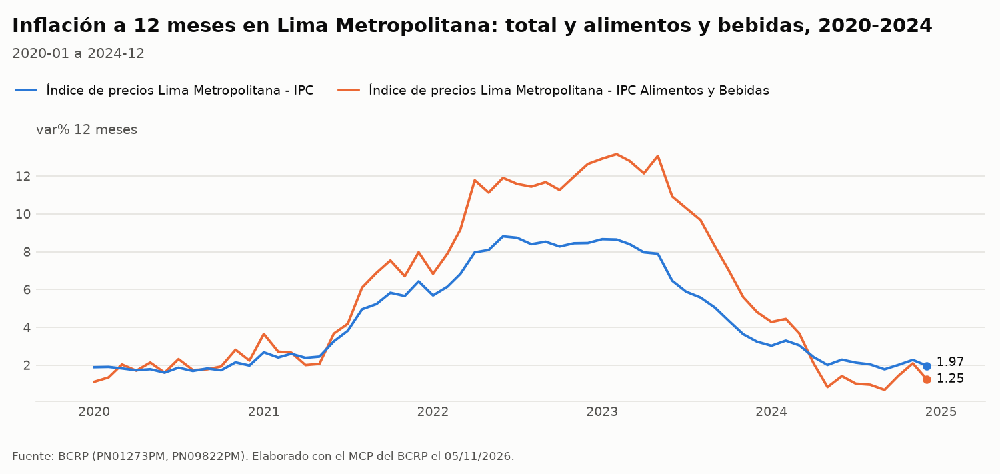
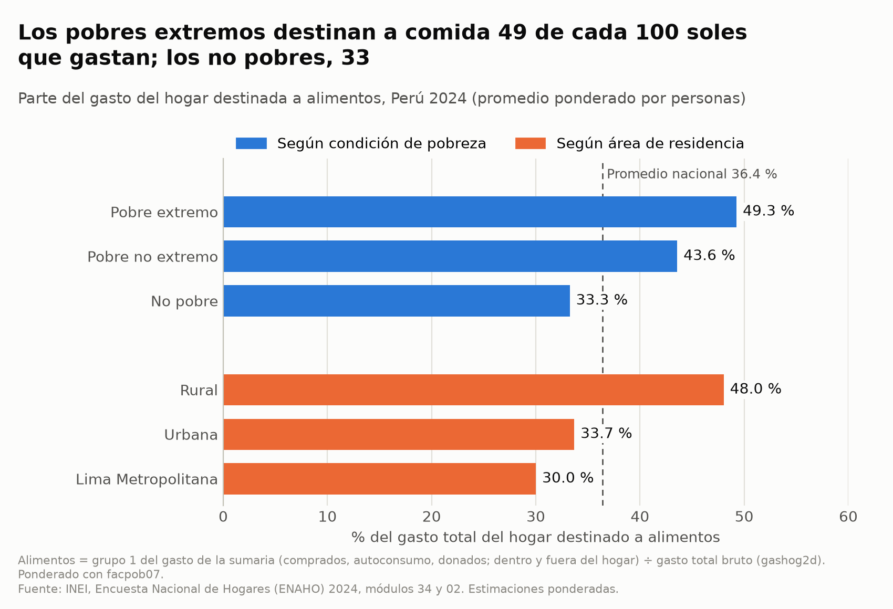
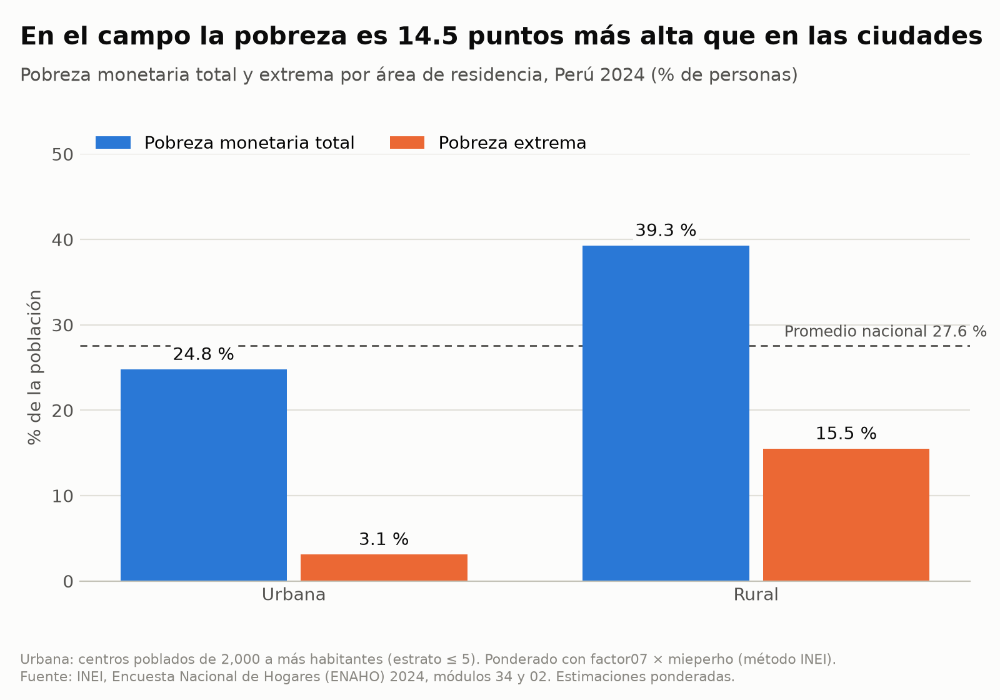
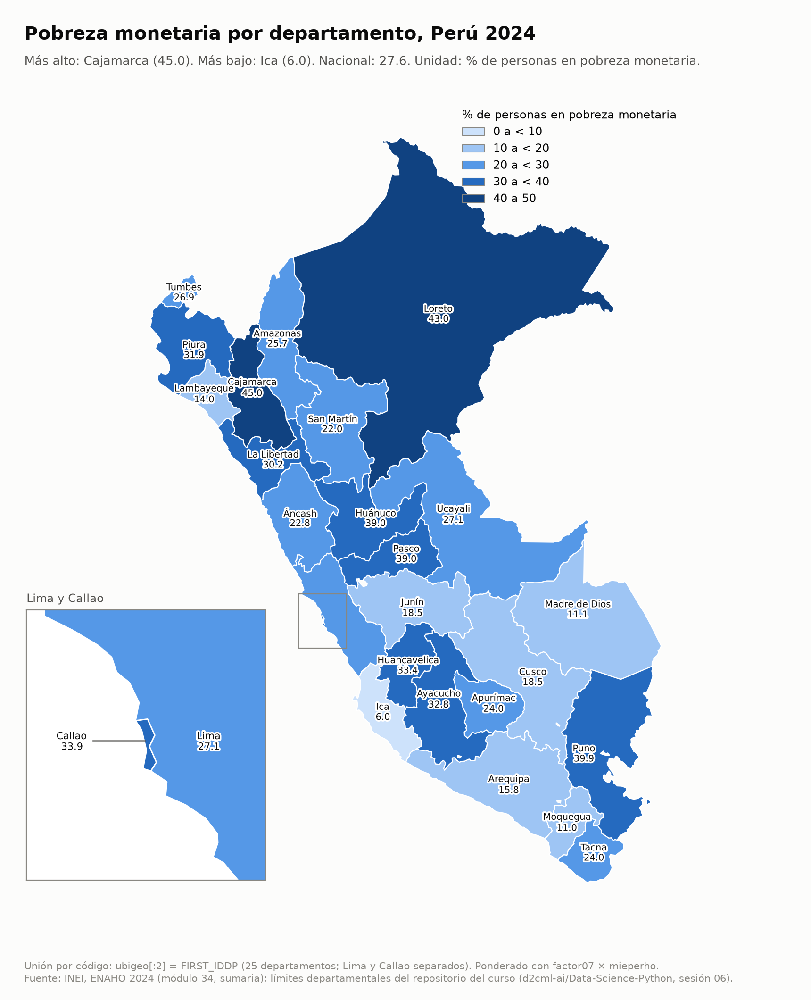
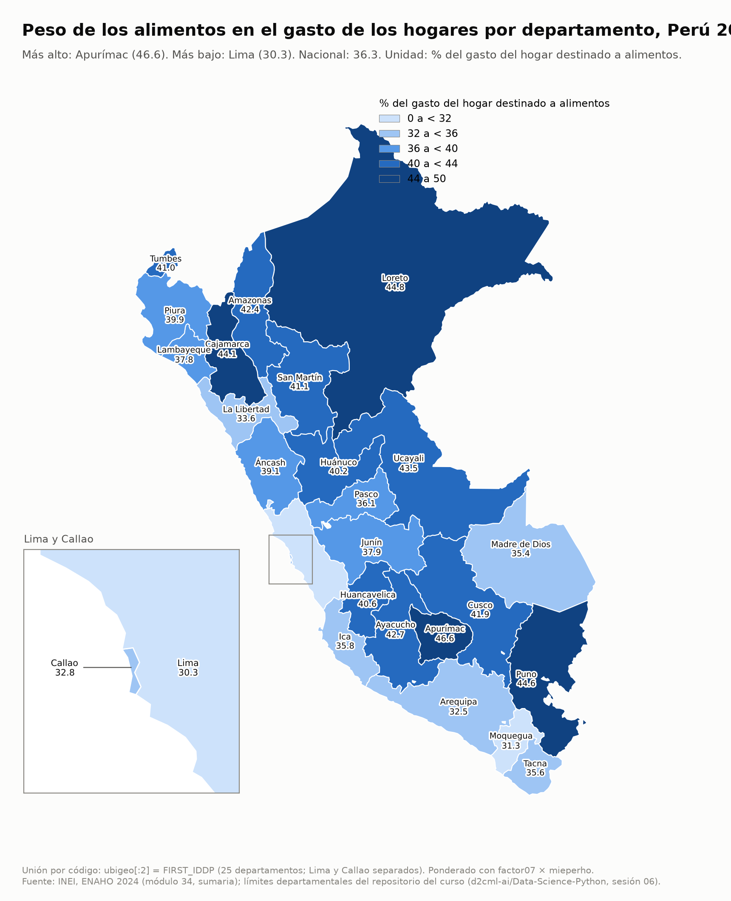

# Precios de los alimentos y exposición de los hogares peruanos: IPC de Lima Metropolitana 2020-2024 y ENAHO 2024

## 1. Pregunta de investigación

**Tema.** Inflación de alimentos y peso de los alimentos en el gasto de los hogares.

**Pregunta.** ¿Cuánto subieron los precios de los alimentos frente al resto de la canasta en Lima Metropolitana entre 2020 y 2024? ¿Qué tan expuestos estaban a esa alza, por el peso de los alimentos en su gasto, los hogares pobres, rurales y de cada departamento en 2024?

**Objetivo.** Combinar dos fuentes oficiales, el IPC del BCRP y la ENAHO 2024 del INEI, para describir cuánto subieron los alimentos y dónde pesan más en el gasto.

**Delimitación.**
- Periodo de precios: dic. 2019 a dic. 2024, mensual. El punto de partida es dic. 2019 para medir el alza acumulada durante 2020-2024.
- Periodo de hogares: un solo año, 2024.
- Territorio de precios: Lima Metropolitana.
- Territorio de hogares: Perú, por área (urbana/rural), condición de pobreza y 25 departamentos (Lima y Callao separados).
- Unidad de análisis: la serie mensual del índice (BCRP) y la persona residente habitual, con su hogar (ENAHO).

## 2. Fuentes y metodología

### BCRP (servidor MCP `bcrp`, series mensuales)

| Código | Serie |
|---|---|
| PN38705PM | IPC Lima Metropolitana, total (índice dic. 2021 = 100) |
| PN39445PM | IPC Alimentos y Bebidas (índice dic. 2021 = 100) |
| PN38706PM | IPC Sin Alimentos y Bebidas (índice dic. 2021 = 100) |
| PN01273PM | IPC total, var. % a 12 meses |
| PN09822PM | IPC Alimentos y Bebidas, var. % a 12 meses |

Herramientas: `comparar_series` (variación acumulada de los índices, dic. 2019 a dic. 2024), `resumen` (promedio y extremos de la inflación a 12 meses, 2020-01 a 2024-12) y `grafico`. Todas las cifras del BCRP salen de esas herramientas.

### ENAHO 2024 (INEI, código 966)

- **Módulos:** 34 (sumaria: gasto, pobreza, factores) y 02 (miembros del hogar: residentes habituales).
- **Base:** 33,691 hogares y 108,664 residentes habituales. Se procesó con la skill `limpiando-enaho`, y la validación pasó las 23 pruebas.
- **Pobreza monetaria territorial** (nacional, urbana/rural, departamento): método INEI, con hogares de la sumaria ponderados por `factor07 × mieperho` (`pobreza_inei_pct`).
- **Peso de los alimentos en el gasto** (`gasto_alimentos_pct`): participación de los alimentos en el gasto total del hogar. En las tablas por área y condición de pobreza se pondera con `facpob07`. En el mapa departamental, la skill `mapeando-enaho` pondera con `factor07 × mieperho`.
- **Ponderaciones:** nunca se usan promedios simples. El promedio simple da 25.61 % de pobreza frente a 27.58 % ponderado (`salidas/validacion.txt`).

## 3. Resultados

### Precios (BCRP, Lima Metropolitana)

1. **Los alimentos subieron más que el IPC total y que el resto de la canasta.** Entre dic. 2019 y dic. 2024 el IPC de alimentos y bebidas acumuló **31.94 %** (PN39445PM, 2019-12 a 2024-12). El IPC total subió **23.91 %** (PN38705PM, mismo periodo) y el IPC sin alimentos y bebidas **18.69 %** (PN38706PM, mismo periodo). Los alimentos quedaron **8.03 pp** sobre el total (`brecha_vs_referencia_pp`, `comparar_series`). El IPC sin alimentos quedó **5.22 pp** por debajo del total (misma salida).
2. **Alza media anual.** Los alimentos subieron **5.70 %** al año (PN39445PM) y el IPC total **4.38 %** (PN38705PM), ambos con variación promedio anual geométrica de dic. 2019 a dic. 2024. El IPC sin alimentos subió **3.49 %** al año (PN38706PM).
3. **Picos de la inflación a 12 meses.** La inflación total llegó a **8.81 %** en 2022-06 (PN01273PM). La de alimentos y bebidas llegó a **13.16 %** en 2023-02 (PN09822PM), 8 meses después del pico total. En 2020-2024 el promedio fue **4.47 %** para el total (PN01273PM) y **5.88 %** para alimentos (PN09822PM).
4. **Cierre de 2024.** En 2024-12 la inflación a 12 meses fue **1.97 %** total (PN01273PM) y **1.25 %** en alimentos (PN09822PM). El mínimo de alimentos fue **0.69 %** en 2024-09 (PN09822PM). El alza acumulada de alimentos se explica por 2021-2023, no por 2024.

### Hogares (ENAHO 2024)

5. **Los hogares rurales y pobres destinan más gasto a alimentos.** El peso de los alimentos es **48.03 %** en el área rural y **33.69 %** en la urbana (`figuras/enaho_alimentos.csv`, columna `pct`). En Lima Metropolitana es **30.00 %** (misma tabla). Para el total nacional es **36.41 %** (`salidas/indicadores.csv`, `gasto_alimentos_pct`, fila Nacional). Por condición de pobreza es **49.27 %** en pobres extremos, **43.58 %** en pobres no extremos y **33.26 %** en no pobres (`figuras/enaho_alimentos.csv`).
6. **Pobreza urbana y rural.** La pobreza monetaria nacional es **27.58 %**, la urbana **24.81 %** y la rural **39.30 %**. La pobreza extrema es **3.14 %** en el área urbana y **15.52 %** en la rural (`figuras/enaho_area.csv`, columnas `pct` y `pct_extrema`; nacional en `salidas/indicadores.csv`, `pobreza_inei_pct`).
7. **Departamentos.** El peso de los alimentos va de **30.3 %** en Lima a **46.6 %** en Apurímac. Siguen Loreto (**44.8 %**), Puno (**44.6 %**) y Cajamarca (**44.1 %**) (`mapas/mapa_gasto_alimentos_departamento.csv`, columna `valor`). Callao (**32.8 %**), Arequipa (**32.5 %**) y Moquegua (**31.3 %**) están cerca de Lima en el extremo bajo (misma tabla).
8. **Pobreza por departamento.** Los más altos son Cajamarca (**45.0 %**), Loreto (**43.0 %**), Puno (**39.9 %**), Pasco y Huánuco (**39.0 %** cada uno). El más bajo es Ica (**6.0 %**) (`mapas/mapa_pobreza_departamento.csv`, columna `valor`).
9. **Exposición alta y pobreza alta no siempre coinciden.** Cajamarca, Loreto y Puno están entre los cinco primeros en ambos indicadores. Apurímac tiene el mayor peso de alimentos (**46.6 %**) con una pobreza de **24.0 %**, intermedia (`mapas/mapa_gasto_alimentos_departamento.csv` y `mapas/mapa_pobreza_departamento.csv`).

## 4. Visualizaciones

**BCRP: inflación a 12 meses, total y alimentos.**



*Lectura: la línea de alimentos (naranja) queda sobre la total (azul) desde mediados de 2021 hasta inicios de 2024. Alcanza su máximo en 2023-02 (13.16 %) y cae por debajo de la total hacia 2024.*

**ENAHO: peso de los alimentos en el gasto, por área y condición de pobreza.**



*Lectura: el peso de los alimentos es mayor en los hogares rurales (48.03 %) y en los pobres extremos (49.27 %) que en Lima Metropolitana (30.00 %) y en los no pobres (33.26 %).*

**ENAHO: pobreza urbana y rural.**



*Lectura: la pobreza rural (39.30 %) es mayor que la urbana (24.81 %).*

**ENAHO: mapa de pobreza monetaria por departamento.**



*Lectura: la pobreza es más alta en Cajamarca (45.0 %) y Loreto (43.0 %) y más baja en Ica (6.0 %).*

**ENAHO: mapa del peso de los alimentos por departamento (complementario).**



*Lectura: el peso de los alimentos es más alto en Apurímac (46.6 %) y Loreto (44.8 %) y más bajo en Lima (30.3 %).*

## 5. Interpretación

Las dos fuentes muestran un patrón conjunto. Los alimentos fueron la parte de la canasta que más se encareció en Lima (31.94 % acumulado frente a 18.69 % del resto). En 2024, los hogares rurales, los pobres y varios departamentos de sierra y selva gastaban en alimentos una parte mayor de su presupuesto que Lima y los hogares no pobres. Un mismo aumento de precios de alimentos pesa entonces más en esos hogares.

Es una asociación descriptiva, no causal. No se mide el efecto de la inflación sobre la pobreza ni sobre el gasto. Tampoco se muestra que los precios de alimentos subieran lo mismo fuera de Lima.

## 6. Limitaciones

- **Cobertura geográfica distinta.** El IPC es de Lima Metropolitana y la ENAHO es nacional. Los hogares de otros departamentos pueden haber enfrentado otra evolución de precios. La comparación más directa es con el dominio Lima Metropolitana (30.00 %).
- **Un solo año.** La ENAHO es de 2024 y no se observa cómo cambió el peso de los alimentos durante 2020-2024. No se puede ver cómo la inflación cambió el gasto.
- **El peso no mide el impacto.** El peso de los alimentos no mide por sí solo el efecto de la inflación. Falta la composición de la canasta de cada hogar, su capacidad de sustitución, su ingreso y si produce sus propios alimentos.
- **Alimentos y bebidas.** El IPC agrupa «alimentos y bebidas» y la ENAHO mide el gasto en alimentos. Las definiciones no son idénticas.
- **Muestra por departamento.** Hay entre 603 hogares (Madre de Dios) y 4,544 (Lima) por departamento. Las cifras departamentales tienen error muestral que no se reporta aquí y las diferencias pequeñas entre departamentos no son concluyentes.
- **Dos ponderaciones del peso de los alimentos.** Las tablas por área y pobreza usan `facpob07` y el mapa usa `factor07 × mieperho`. Por eso difieren las cifras departamentales de `salidas/indicadores.csv` y del mapa. Por ejemplo, Apurímac es 47.05 % en `salidas/indicadores.csv` y 46.6 % en el mapa. Lima es 30.25 % y 30.3 %. No cambia el orden general, pero conviene citar la fuente de cada cifra.
- **Brecha frente al total.** El IPC total ya incluye a los alimentos, por lo que la brecha de 8.03 pp es frente a un índice que los contiene.

## 7. Reproducibilidad

**BCRP (servidor MCP `bcrp`):**

- `comparar_series("PN38705PM,PN39445PM,PN38706PM", "2019-12", "2024-12")`
- `resumen("PN01273PM", "2020-01", "2024-12")` y `resumen("PN09822PM", "2020-01", "2024-12")`
- `grafico("PN01273PM,PN09822PM", "2020-01", "2024-12")`

URL de las series:
- https://estadisticas.bcrp.gob.pe/estadisticas/series/api/PN38705PM/json/2019-12/2024-12
- https://estadisticas.bcrp.gob.pe/estadisticas/series/api/PN39445PM/json/2019-12/2024-12
- https://estadisticas.bcrp.gob.pe/estadisticas/series/api/PN38706PM/json/2019-12/2024-12
- https://estadisticas.bcrp.gob.pe/estadisticas/series/api/PN01273PM/json/2020-1/2024-12
- https://estadisticas.bcrp.gob.pe/estadisticas/series/api/PN09822PM/json/2020-1/2024-12

**ENAHO** (desde la raíz del proyecto; datos en `datos/966-Modulo34.zip` y `datos/966-Modulo02.zip`):

```bash
uv run .claude/skills/limpiando-enaho/scripts/limpiar.py
uv run .claude/skills/graficando-enaho/scripts/graficar.py --tipo alimentos
uv run .claude/skills/graficando-enaho/scripts/graficar.py --tipo area
uv run .claude/skills/mapeando-enaho/scripts/mapear.py --indicador pobreza
uv run .claude/skills/mapeando-enaho/scripts/mapear.py --indicador gasto_alimentos
```

**Archivos de salida:**
- `salidas/validacion.txt`, `salidas/indicadores.csv`, `salidas/comparacion_mapa.csv`, `salidas/personas_2024.parquet`, `salidas/hogares_2024.parquet`
- `figuras/bcrp_PN01273PM_PN09822PM_niveles_2020-01_2024-12.png`
- `figuras/enaho_alimentos.png` y `.csv`, `figuras/enaho_area.png` y `.csv`
- `mapas/mapa_pobreza_departamento.png` y `.csv`, `mapas/mapa_gasto_alimentos_departamento.png` y `.csv`

### Contraste con referencias oficiales

| Indicador | Referencia INEI | Calculado (`salidas/indicadores.csv`, `pobreza_inei_pct`) | Diferencia |
|---|---|---|---|
| Pobreza nacional | 27.6 % | 27.58 % | 0.02 pp |
| Pobreza urbana | 24.8 % | 24.81 % | 0.01 pp |
| Pobreza rural | 39.3 % | 39.30 % | 0.00 pp |

Los 25 departamentos coinciden con la referencia de la sesión 16 a 0.1 pp o menos (diferencia máxima 0.00 pp; `salidas/comparacion_mapa.csv`).

Ninguna herramienta falló y todas las series devolvieron datos.

## Trazabilidad de cifras

| Cifra | Origen |
|---|---|
| 23.91 % (IPC total acumulado) | `comparar_series`, PN38705PM, 2019-12 a 2024-12, `variacion_acumulada_pct` |
| 31.94 % (alimentos y bebidas acumulado) | `comparar_series`, PN39445PM, 2019-12 a 2024-12, `variacion_acumulada_pct` |
| 18.69 % (sin alimentos y bebidas acumulado) | `comparar_series`, PN38706PM, 2019-12 a 2024-12, `variacion_acumulada_pct` |
| 8.03 pp y 5.22 pp (brechas vs total) | `comparar_series`, `brecha_vs_referencia_pp` (alimentos +8.0329; sin alimentos −5.2199) |
| 4.38 %, 5.70 % y 3.49 % (alza media anual) | `comparar_series`, `variacion_promedio_anual_pct`, PN38705PM, PN39445PM, PN38706PM |
| 8.81 % en 2022-06 | `resumen`, PN01273PM, 2020-01 a 2024-12, `maximo` |
| 13.16 % en 2023-02 | `resumen`, PN09822PM, 2020-01 a 2024-12, `maximo` |
| 4.47 % y 5.88 % (promedios 2020-2024) | `resumen`, PN01273PM y PN09822PM, `promedio` |
| 1.97 % y 1.25 % (2024-12) | `resumen`, PN01273PM y PN09822PM, `ultimo` |
| 0.69 % en 2024-09 | `resumen`, PN09822PM, `minimo` |
| 48.03 %, 33.69 % y 30.00 % | `figuras/enaho_alimentos.csv`, `pct` (Rural, Urbana, Lima Metropolitana) |
| 49.27 %, 43.58 % y 33.26 % | `figuras/enaho_alimentos.csv`, `pct` (Pobre extremo, Pobre no extremo, No pobre) |
| 36.41 % (nacional) | `salidas/indicadores.csv`, `gasto_alimentos_pct`, fila Nacional |
| 27.58 %, 24.81 % y 39.30 % | `salidas/indicadores.csv`, `pobreza_inei_pct`; `figuras/enaho_area.csv`, `pct` |
| 3.14 % y 15.52 % (pobreza extrema) | `figuras/enaho_area.csv`, `pct_extrema` |
| 46.6 %, 44.8 %, 44.6 %, 44.1 %, 32.8 %, 32.5 %, 31.3 % y 30.3 % | `mapas/mapa_gasto_alimentos_departamento.csv`, `valor` (Apurímac, Loreto, Puno, Cajamarca, Callao, Arequipa, Moquegua, Lima) |
| 45.0 %, 43.0 %, 39.9 %, 39.0 %, 24.0 % y 6.0 % | `mapas/mapa_pobreza_departamento.csv`, `valor` (Cajamarca, Loreto, Puno, Pasco y Huánuco, Apurímac, Ica) |
| 47.05 % y 30.25 % (Apurímac y Lima con `facpob07`) | `salidas/indicadores.csv`, `gasto_alimentos_pct` |
| 603 y 4,544 hogares (Madre de Dios y Lima) | `mapas/*_departamento.csv`, `hogares_muestra` |
| 33,691 hogares y 108,664 residentes | `salidas/validacion.txt` |
| 25.61 % (promedio simple) y 27.58 % | `salidas/validacion.txt` |
| 27.6 %, 24.8 % y 39.3 % (referencias) | INEI, citadas en el enunciado y en `salidas/validacion.txt` |
| 23 validaciones aprobadas | `salidas/validacion.txt` |
| 25/25 departamentos a ≤ 0.1 pp | `salidas/comparacion_mapa.csv`, `coincide` |
